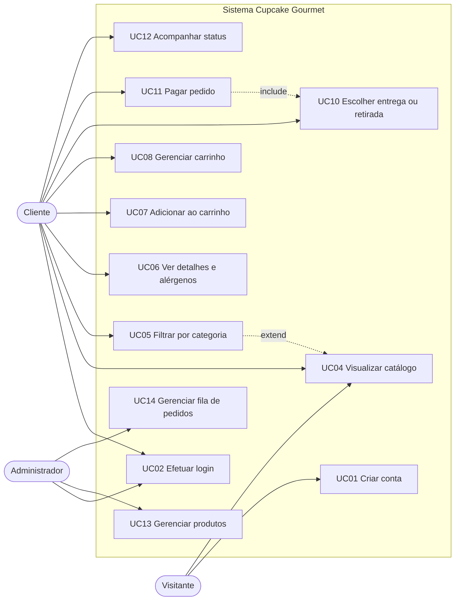
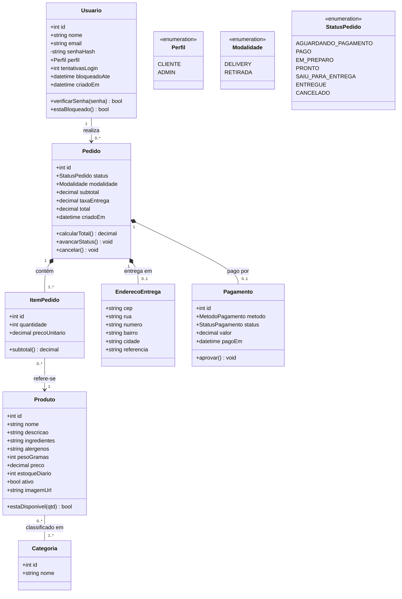
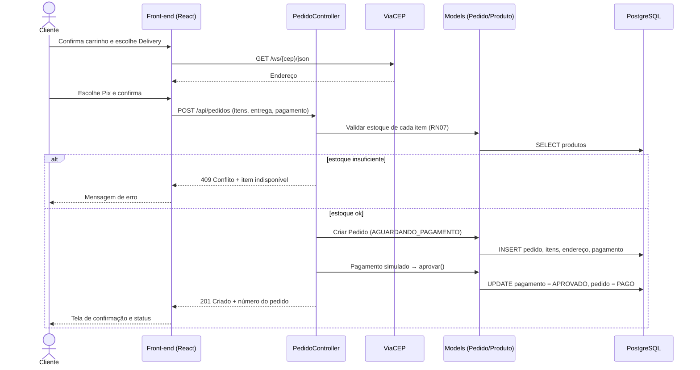
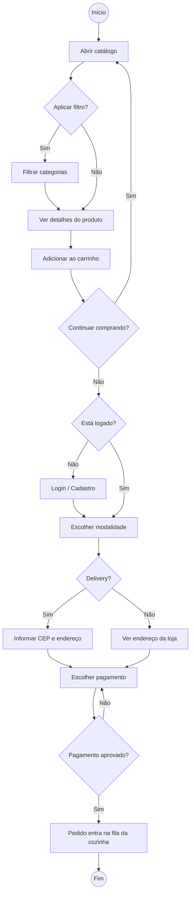
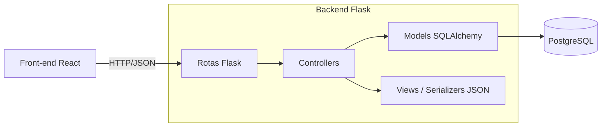

# Diagramas UML

> Os diagramas estão em Mermaid e são renderizados automaticamente pelo GitHub.

## 1. Casos de Uso

## 2. Diagrama de Classes (domínio / persistência)

## 3. Diagrama de Sequência — Fechar pedido (UC10 + UC11)

## 4. Diagrama de Atividades — Jornada de compra

## 5. Arquitetura MVC do back-end

