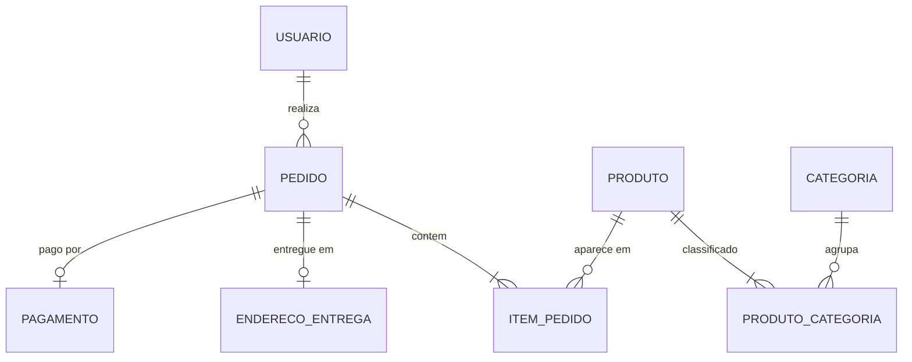

# Projeto de Dados

## 1. Modelo Conceitual (DER)

## 2. Modelo Lógico (normalizado)

- **usuario** (<u>id</u>, nome, email, senha_hash, perfil, tentativas_login, bloqueado_ate, criado_em)
- **categoria** (<u>id</u>, nome)
- **produto** (<u>id</u>, nome, descricao, ingredientes, alergenos, peso_gramas, preco, estoque_diario, ativo, imagem_url, criado_em)
- **produto_categoria** (<u>produto_id</u> → produto, <u>categoria_id</u> → categoria)
- **pedido** (<u>id</u>, usuario_id → usuario, status, modalidade, subtotal, taxa_entrega, total, criado_em, atualizado_em)
- **item_pedido** (<u>id</u>, pedido_id → pedido, produto_id → produto, quantidade, preco_unitario)
- **endereco_entrega** (<u>pedido_id</u> → pedido, cep, rua, numero, bairro, cidade, referencia)
- **pagamento** (<u>id</u>, pedido_id → pedido, metodo, status, valor, pago_em)

### Verificação das formas normais

- **1FN:** todos os atributos são atômicos. As categorias, que seriam um atributo multivalorado de produto, foram para a tabela `produto_categoria`.
- **2FN:** nas tabelas com chave composta (`produto_categoria`) não há atributos não-chave; nas demais a chave é simples.
- **3FN:** não há dependências transitivas. O endereço fica em tabela própria, ligada ao pedido. O cliente pode mudar de endereço entre compras, e o pedido precisa guardar o endereço daquela entrega.
- **Desnormalizações conscientes:**
  - `item_pedido.preco_unitario` guarda o preço do momento da compra (RN10). O preço do produto pode mudar depois, e o histórico não pode mudar junto.
  - `pedido.total` existe para consulta rápida e é protegido pela restrição `CHECK (total = subtotal + taxa_entrega)`.

## 3. Projeto Físico

Script completo em [`schema.sql`](schema.sql) (PostgreSQL).

## 4. Dicionário de Dados

### usuario
| Campo | Tipo | Nulo | Chave | Domínio / Regra | Descrição |
|---|---|---|---|---|---|
| id | SERIAL | Não | PK | Inteiro autoincremento | Identificador do usuário |
| nome | VARCHAR(120) | Não | | Texto | Nome completo |
| email | VARCHAR(160) | Não | UNIQUE | E-mail válido (RN01) | Login do usuário |
| senha_hash | VARCHAR(255) | Não | | Hash bcrypt (RN11) | Senha criptografada |
| perfil | ENUM | Não | | CLIENTE, ADMIN | Tipo de acesso |
| tentativas_login | SMALLINT | Não | | ≥ 0, padrão 0 | Falhas consecutivas de login (RN03) |
| bloqueado_ate | TIMESTAMP | Sim | | Data/hora futura | Fim do bloqueio temporário |
| criado_em | TIMESTAMP | Não | | Padrão NOW() | Data de cadastro |

### categoria
| Campo | Tipo | Nulo | Chave | Domínio / Regra | Descrição |
|---|---|---|---|---|---|
| id | SERIAL | Não | PK | | Identificador |
| nome | VARCHAR(60) | Não | UNIQUE | Ex.: Veganos, Sem Glúten | Nome da categoria/restrição |

### produto
| Campo | Tipo | Nulo | Chave | Domínio / Regra | Descrição |
|---|---|---|---|---|---|
| id | SERIAL | Não | PK | | Identificador |
| nome | VARCHAR(100) | Não | | | Nome do cupcake |
| descricao | TEXT | Não | | | Descrição comercial |
| ingredientes | TEXT | Não | | | Lista completa de ingredientes (HU 06) |
| alergenos | VARCHAR(255) | Sim | | Ex.: "Contém glúten" | Avisos de alérgenos |
| peso_gramas | INTEGER | Não | | > 0 | Peso da unidade |
| preco | NUMERIC(10,2) | Não | | > 0 | Preço unitário atual |
| estoque_diario | INTEGER | Não | | ≥ 0 | Unidades disponíveis no dia (RN07) |
| ativo | BOOLEAN | Não | | Padrão TRUE | Se aparece no catálogo (RN04) |
| imagem_url | VARCHAR(500) | Sim | | URL de imagem WebP | Foto do produto |
| criado_em | TIMESTAMP | Não | | Padrão NOW() | Data de cadastro |

### produto_categoria
| Campo | Tipo | Nulo | Chave | Domínio / Regra | Descrição |
|---|---|---|---|---|---|
| produto_id | INTEGER | Não | PK, FK → produto | | Produto |
| categoria_id | INTEGER | Não | PK, FK → categoria | | Categoria do produto (RN05) |

### pedido
| Campo | Tipo | Nulo | Chave | Domínio / Regra | Descrição |
|---|---|---|---|---|---|
| id | SERIAL | Não | PK | | Número do pedido |
| usuario_id | INTEGER | Não | FK → usuario | | Cliente que fez o pedido |
| status | ENUM | Não | | Ver ciclo de vida no escopo | Situação atual |
| modalidade | ENUM | Não | | DELIVERY, RETIRADA | Forma de entrega (HU 10) |
| subtotal | NUMERIC(10,2) | Não | | ≥ 0 | Soma dos itens |
| taxa_entrega | NUMERIC(10,2) | Não | | ≥ 0; fixa no delivery, 0 na retirada | Frete (RN08) |
| total | NUMERIC(10,2) | Não | | = subtotal + taxa_entrega | Valor final |
| criado_em | TIMESTAMP | Não | | Padrão NOW() | Data do pedido |
| atualizado_em | TIMESTAMP | Não | | Padrão NOW() | Última mudança de status |

### item_pedido
| Campo | Tipo | Nulo | Chave | Domínio / Regra | Descrição |
|---|---|---|---|---|---|
| id | SERIAL | Não | PK | | Identificador |
| pedido_id | INTEGER | Não | FK → pedido | Único com produto_id | Pedido ao qual pertence |
| produto_id | INTEGER | Não | FK → produto | | Produto comprado |
| quantidade | INTEGER | Não | | ≥ 1 (RN06) | Unidades |
| preco_unitario | NUMERIC(10,2) | Não | | > 0 (RN10) | Preço no momento da compra |

### endereco_entrega
| Campo | Tipo | Nulo | Chave | Domínio / Regra | Descrição |
|---|---|---|---|---|---|
| pedido_id | INTEGER | Não | PK, FK → pedido | Só para DELIVERY | Pedido |
| cep | CHAR(8) | Não | | 8 dígitos, validado no ViaCEP | CEP |
| rua | VARCHAR(150) | Não | | | Logradouro |
| numero | VARCHAR(10) | Não | | | Número |
| bairro | VARCHAR(100) | Não | | | Bairro |
| cidade | VARCHAR(100) | Não | | | Cidade |
| referencia | VARCHAR(150) | Sim | | | Ponto de referência |

### pagamento
| Campo | Tipo | Nulo | Chave | Domínio / Regra | Descrição |
|---|---|---|---|---|---|
| id | SERIAL | Não | PK | | Identificador |
| pedido_id | INTEGER | Não | FK → pedido, UNIQUE | 1 pagamento por pedido | Pedido pago |
| metodo | ENUM | Não | | PIX, CARTAO | Forma de pagamento |
| status | ENUM | Não | | PENDENTE, APROVADO, RECUSADO | Situação (simulada no MVP) |
| valor | NUMERIC(10,2) | Não | | > 0, igual ao total do pedido | Valor pago |
| pago_em | TIMESTAMP | Sim | | Preenchido ao aprovar | Data da aprovação |
